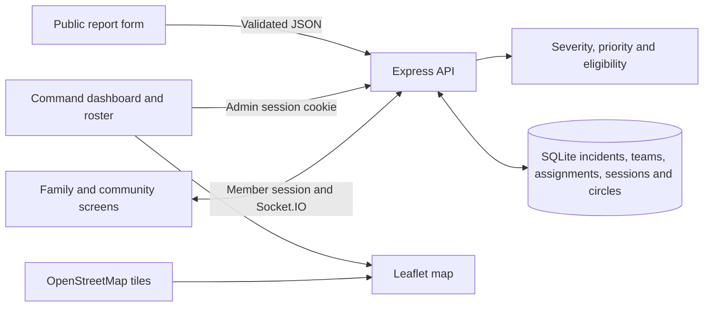
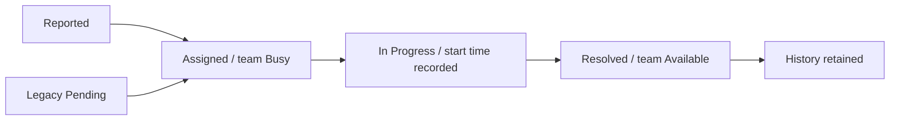

# ResQOps

ResQOps is an emergency reporting and coordination prototype that connects public reports to an authenticated incident queue, a response team roster, and a shared operational map.

[ResQOps source repository](https://github.com/Merfinhanson/ResQOps)


ResQOps is a Code Clash 2026 demonstration. It records reports and assignments for evaluation. It does not dispatch responders or notify emergency services.

## Problem

An incident form can collect a location and description, but it leaves operators to compare emergencies, check team availability, and maintain assignment history by hand. ResQOps gives operators a queue with explainable priorities and a list of eligible teams sorted by distance. The operator confirms an assignment, and the database records the incident status, team availability, and assignment together. People who cannot provide GPS can still submit a report and supply a landmark. An administrator can add coordinates later.

## Feature matrix

| Feature | Subsystem | Engineering mechanism | Visible result | Verified status |
| --- | --- | --- | --- | --- |
| Public reporting and severity | [Report.tsx](frontend/src/Report.tsx), [server.js](backend/src/server.js), [severity.js](backend/src/severity.js) | Six categories, Zod validation, deterministic severity, SQLite insert | Incident reference, severity and explanation | HTTP tests, browser submission and refresh |
| Priority queue | [operations.js](backend/src/operations.js), [App.tsx](frontend/src/App.tsx) | Four capped scores and deterministic ordering | Score, rank, age, severity, and point breakdown | Unit and HTTP tests, browser |
| Response teams | [operations.js](backend/src/operations.js), [Operations.tsx](frontend/src/Operations.tsx) | Validated coordinates, roster CRUD, archive guard | Team availability, position and assignment link | HTTP restart test and browser creation |
| Recommendation and assignment | [operations.js](backend/src/operations.js), [Operations.tsx](frontend/src/Operations.tsx) | Capability filter, Haversine ranking, SQLite transaction and unique indexes | Eligible teams with distance and confirmation | Unit and HTTP tests, browser confirmation |
| Lifecycle and history | [operations.js](backend/src/operations.js), [Operations.tsx](frontend/src/Operations.tsx) | Assignment timestamps and transactional team release | Assigned → In Progress → Resolved, history panel | HTTP tests, browser lifecycle |
| Map and analytics | [HotspotMap.tsx](frontend/src/HotspotMap.tsx), [App.tsx](frontend/src/App.tsx), [operations.js](backend/src/operations.js) | Stored coordinates and SQL aggregates | Incident/team markers, connection, category chart and seven metrics | HTTP analytics assertions and browser map check |
| Family and Community Circles | [circles.js](backend/src/circles.js), [Circles.tsx](frontend/src/Circles.tsx), [CircleChat.tsx](frontend/src/CircleChat.tsx) | Member sessions, hashed invitations, SQLite messages and Socket.IO | Private groups, chat, check-ins and group alerts | Family invite, chat, alert acknowledgement, moderation privacy and leaving tested over HTTP/Socket.IO. Community approval was not exercised this run. |
| GPS and voice entry | [Report.tsx](frontend/src/Report.tsx) | Explicit browser location action, editable coordinates and speech transcript | Optional inputs with manual form entry | Manual coordinates and typed submission verified. Live GPS permission and audio recognition were not run. |

## Stack

Versions below are resolved by [package-lock.json](package-lock.json), with the Node and SQLite versions measured on the evaluation machine.

| Layer | Version | Role |
| --- | --- | --- |
| Node.js and bundled SQLite | Node 24.14.1, SQLite 3.51.2 | HTTP runtime and durable storage through `node:sqlite` |
| React and React Router | 18.3.1 and 6.30.6 | Public report, command dashboard, team roster and Circles views |
| TypeScript and Vite | 5.7.3 and 6.4.6 | Typechecking, development proxy and production bundle |
| Express and express-session | 4.22.3 and 1.19.0 | API routes and signed, HTTP-only session cookies with a SQLite store |
| Zod and React Hook Form | 3.25.76 and 7.91.0 | Server request validation and form feedback |
| bcryptjs | 2.4.3 | Password hashing and verification |
| Leaflet and React Leaflet | 1.9.4 and 4.2.1 | Map, stored coordinates, markers and connection line |
| Recharts | 2.15.4 | Category and severity charts |
| Socket.IO | 4.8.4 | Live circle messages and group events |

```text
.
├── .env.example                   # Runtime configuration template
├── package.json                   # npm workspaces and evaluation commands
├── package-lock.json              # Resolved dependencies
├── backend/
│   ├── src/
│   │   ├── server.js              # API, sessions and incident storage
│   │   ├── severity.js            # Round 1 categories and severity rules
│   │   ├── operations.js          # Round 2 schema, queue, roster and analytics
│   │   ├── circles.js             # Member APIs and Socket.IO events
│   │   └── seed.js                # Optional labelled fixtures
│   └── tests/                     # Severity, operations and live HTTP tests
├── frontend/
│   ├── vite.config.ts             # Development API and WebSocket proxy
│   └── src/
│       ├── App.tsx                # Routes, command dashboard and filters
│       ├── Report.tsx             # Public intake, voice and optional GPS
│       ├── Operations.tsx         # Roster, drawer and assignment controls
│       ├── HotspotMap.tsx         # Incident and team map
│       ├── Circles.tsx            # Circle membership screens
│       ├── CircleChat.tsx          # Live chat and alerts
│       └── command.css            # Command center theme and responsive layout
└── docs/screenshots/              # Captured from the running local demo
```

## Reproducible Evaluation

Use Node.js 24 and its bundled npm. From the repository root, install dependencies and create your local configuration. Run the following in PowerShell.

```powershell
npm ci
if (-not (Test-Path .env)) { Copy-Item .env.example .env }
node -e "console.log(require('node:crypto').randomBytes(32).toString('hex'))"
node -e "console.log(require('bcryptjs').hashSync('ChangeThisLocalDemoPass!', 12))"
```

Set `SESSION_SECRET` in `.env` to the random value from the first command. Set `ADMIN_PASSWORD_HASH` to the second command's output and choose `ADMIN_USERNAME`. The example password is a disposable local demonstration credential. Use the password you hashed to sign in. The app has no built-in admin account. Keep `.env` private.

```powershell
npm run seed   # Optional. Adds four incidents and four teams with DEMO labels.
npm run dev
```

- Frontend [http://localhost:5173](http://localhost:5173)
- Admin login [http://localhost:5173/admin/login](http://localhost:5173/admin/login)
- Teams [http://localhost:5173/admin/teams](http://localhost:5173/admin/teams)
- API health [http://127.0.0.1:3001/api/health](http://127.0.0.1:3001/api/health)

The database defaults to `backend/data/resqops.sqlite`. Set an absolute `DATA_DIR` for a separate evaluation database. Use the same value when seeding and serving. Migrations create missing tables and add missing GPS columns to earlier incident tables. Seed records use stable IDs and skip existing IDs, including any demo records already assigned or resolved.

1. Sign in and open **Priority Queue**. Select **DEMO · Multi vehicle collision** or use **New Report** to submit a Road Accident with a landmark, 12 people affected, and manual coordinates `13.0827, 80.2707`.
2. Review the Critical severity, the 0–100 score, the point breakdown and waiting time. If GPS is missing, enter coordinates in the incident drawer.
3. Open **Manage Teams** to inspect or create a team. Return to the incident. With the seed fixtures, the available junction medical team is about 1.11 km away. The closer Busy team and unsuitable fire team are excluded.
4. Select **Assign Team**, review the recommendation and confirm. The roster shows Busy, the incident shows Assigned, and the map shows the linked coordinates.
5. Select **Mark In Progress**, then **Mark Resolved**. The team returns to Available. Review timestamps under **Assignment history** and choose **Resolved** in the queue filter to find the incident again.
6. Refresh the dashboard and compare total, critical, available teams, busy teams, assigned, resolved, and category distribution. For a restart check, stop and rerun `npm run dev` with the same `DATA_DIR`.

```powershell
npm ls --depth=0
npm test
npm run build
```

Observed results with Node 24.14.1: dependencies resolved, **10 tests passed, 0 failed**, and TypeScript plus Vite completed the production build. An intermediate TypeScript build rejected `Array.at` under the existing target, so the drawer now uses standard array indexing. Node emitted its SQLite experimental notice. Vite emitted its large chunk warning for the approximately 978 kB minified JavaScript bundle.

Browser verification used the running app with fictional SQLite records. It submitted a public report, found it after browser reload, created a team, confirmed the nearest eligible team on desktop, then started and resolved the assignment in a mobile viewport. The mobile queue used cards without page overflow. Live HTTP tests independently restarted the API, checked a persisted session and records, and sent two competing requests for the same team. One returned 201 and the other 409.

## API smoke examples

The automated HTTP tests use these endpoints against a temporary database. The following PowerShell example submits a fictional incident and queries it using a local admin session. Run it on an evaluation instance.

```powershell
$api = 'http://127.0.0.1:3001/api'
Invoke-RestMethod "$api/health"
$report = @{
  title = 'DEMO API road accident'
  description = 'Fictional road incident for API evaluation.'
  category = 'Road Accident'
  location = 'DEMO junction'
  peopleAffected = 12
  latitude = 13.0827
  longitude = 80.2707
} | ConvertTo-Json
$incident = (Invoke-RestMethod "$api/incidents" -Method Post -ContentType 'application/json' -Body $report).incident
$credentials = @{ username = (Read-Host 'Admin username'); password = (Read-Host 'Local demo password' -MaskInput) } | ConvertTo-Json
Invoke-RestMethod "$api/admin/login" -Method Post -ContentType 'application/json' -Body $credentials -SessionVariable judgeSession
Invoke-RestMethod "$api/admin/incidents/$($incident.id)/recommendations" -WebSession $judgeSession
Invoke-RestMethod "$api/admin/analytics" -WebSession $judgeSession
```

| Request | Response contract |
| --- | --- |
| `GET /api/health` | 200 with `{ ok, service }` |
| `POST /api/incidents` | 201 with `{ incident: { id, category, severity, severityReason, status, createdAt } }`. Invalid submissions return 400. |
| `GET /api/admin/priority-queue` | 200 with `{ incidents }`. Each row has `priority` and `rank`. Use `?status=Resolved` for resolved records. |
| `GET /api/admin/teams` | 200 with `{ teams }`, including `availability` and `assignedIncidentId`. |
| `GET /api/admin/incidents/:id/recommendations` | 200 with `{ assignments, needsLocation, assignedTeam, assignedDistanceKm, recommendations }`. |
| `POST /api/admin/incidents/:id/assign` | Accepts `{ teamId }`. Returns 201 with `{ incident, assignments, team }`. A stale or unsuitable choice returns 409. |
| `PATCH /api/admin/incidents/:id/status` | Accepts `{ status }`. Returns 200 with `{ incident }` or 409 for an invalid lifecycle transition. |
| `GET /api/admin/analytics` | Returns aggregate counts including `total`, `critical`, `availableTeams`, `busyTeams`, `assigned`, `resolved`, and `categories`. |

Protected routes return 401 without an admin session. Public report responses omit contact details. Contact information is accessible to authenticated operators in incident details.

## Architecture and workflow





- **Severity** starts with the six Round 1 categories. The classifier checks critical count and keyword rules before high, medium and low rules. An admin severity override records a reason. Severity is an initial estimate.
- **Priority** is recalculated at query time. The editable `priorityRules` in `operations.js` gives Critical/High/Medium/Low 40/30/18/8 points, up to 25 points for people affected, up to 20 waiting points at one point per ten minutes, and up to 15 category points. Higher scores come first. Ties use the older submission timestamp, then incident ID. Resolved rows are excluded by default.
- **Suitability** uses a compatibility matrix. Fire uses Fire or Rescue. Road Accident uses Medical or Rescue. Medical Emergency uses Medical. Flood and Building Collapse use Rescue. Other Emergencies use General Emergency or Rescue. Candidates must be unassigned, Available, and have valid coordinates. Haversine uses radians and a 6,371 km radius. Distance ties use team ID.
- **Assignment** uses `BEGIN IMMEDIATE` and partial unique indexes for one active assignment per incident and team. The server rechecks eligibility in the transaction and stores the assignment and both state changes before committing. Resolution records its timestamp and releases the team in the same transaction. Assigned teams cannot be removed or manually released. Reports with assignment history are retained. Duplicate or test reports without history can be deleted.
- **Map** shows stored positions with severity and team availability styles, filters, and popups. The selected team and incident are connected by an approximate straight line. Incidents without coordinates remain searchable and have a separate list. If tiles are unavailable, the page displays a notice and retains the markers. Map tiles require internet access. There is no routing provider or ETA.
- **Analytics** counts all stored incident records, including explicitly labelled fixtures when seeded. Assigned means incident status is exactly Assigned. In Progress has its own count. Active assignments count unresolved assignment rows. The dashboard reloads after mutations and polls every 15 seconds while visible to pick up external submissions and roster updates.

## Round 2 compliance

| Requirement | Implementation and API | UI | Evidence |
| --- | --- | --- | --- |
| 1. Intelligent prioritization | [operations.js](backend/src/operations.js), `GET /api/admin/priority-queue` | `/admin` queue and detail drawer | Passed **priority changes with each factor, stays bounded, and uses Haversine distance**. Live HTTP confirms ranked output and resolved filtering. |
| 2. Team management | [operations.js](backend/src/operations.js), `/api/admin/teams` | `/admin/teams` | Passed **team persistence, recommendations, assignment conflicts, lifecycle and analytics**. HTTP restarted the server and read the edited team. |
| 3. Nearest team assignment | [operations.js](backend/src/operations.js), `/recommendations` and `/assign` under an admin incident | `/admin` assignment drawer | Passed fixed-distance and eligibility checks, the competing HTTP requests, and browser confirmation. |
| 4. Assignment tracking | [operations.js](backend/src/operations.js), `PATCH /api/admin/incidents/:id/status` | `/admin` stepper and history | Passed **HTTP reports, persistent sessions and teams, atomic competing requests, and lifecycle analytics**. Browser verified team release. |
| 5. Route and location visualization | [HotspotMap.tsx](frontend/src/HotspotMap.tsx), [Operations.tsx](frontend/src/Operations.tsx), incident and team APIs | `/admin` map and drawer | Browser verified stored markers, a visible connection and distance label. [Assignment screenshot](docs/screenshots/assignment.jpg). |
| 6. Advanced analytics | [operations.js](backend/src/operations.js), `GET /api/admin/analytics` | `/admin` tiles and chart | HTTP asserted all seven metrics and state changes, including Assigned dropping to zero when response begins. |

## Feasibility and limits

The npm workspaces and local SQLite database require no paid API key. Browser GPS and speech support vary by browser and permission. Speech may use a browser vendor service. Typed reports, manually entered coordinates and map overlays are available independently of speech. The Circles alert reaches circle members within the app. This workspace has no separate SOS or splash module, and no glossy bitmap logo asset. The existing wordmark is rendered from text and an icon.

A single Node process and SQLite WAL suit a local prototype. Prioritization currently loads and ranks incident rows in memory. A larger installation would need measured query and write load, pagination, a deployment-specific tile service, and a shared session and Socket.IO strategy before running multiple API instances. External dispatch, hardened account administration, backups and production operations are outside the evaluation build. No load benchmark was run.

The project differs from a report-only form by linking each incident to a compatible team, exposing the score and distance used in the decision, and preserving the status trail. Category shortcuts and optional voice entry reduce form friction. Circles provide a separate coordination channel for invited family members and participating community members.

The supplied materials did not include the judges' PulseStream example file. This README follows the structure described in the brief. No license file, team roster or public deployment URL was present in the workspace.

## Screenshots


[Assignment drawer and map](docs/screenshots/assignment.jpg) · [Mobile priority queue](docs/screenshots/mobile-queue.jpg)
