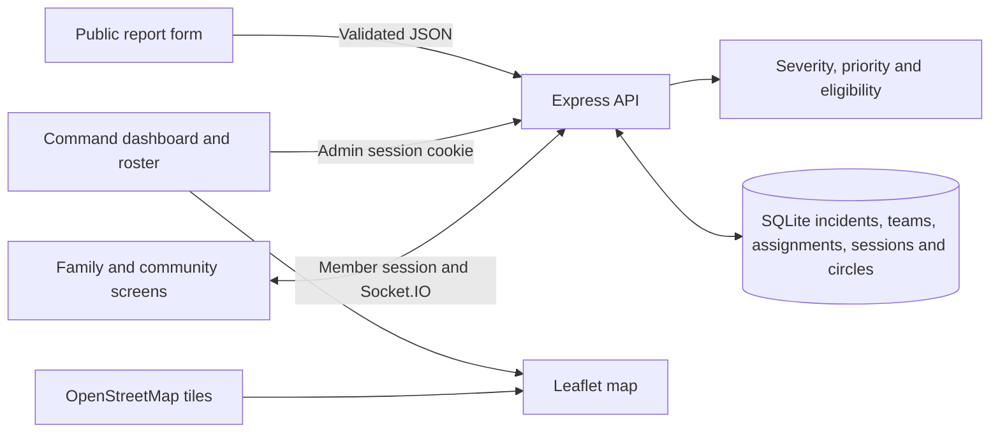
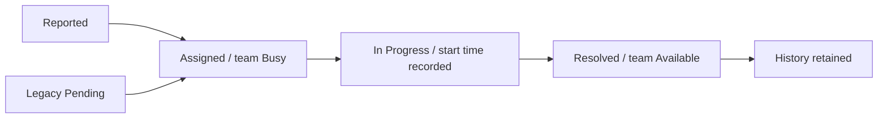
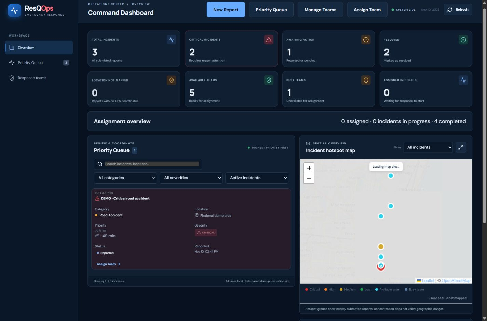

# ResQOps

**Code Clash 2026 · Round 2**

An emergency coordination prototype with explainable severity, priority ranking and transaction-safe team assignment.

[ResQOps source repository](https://github.com/Merfinhanson/ResQOps)


ResQOps is a Code Clash 2026 demonstration. It records reports and assignments for evaluation. It does not dispatch responders or notify emergency services.

## Problem statement

An incident form can collect a location and description, but it leaves operators to compare emergencies, check team availability, and maintain assignment history by hand. ResQOps gives operators a queue with explainable priorities and a list of eligible teams sorted by distance. The operator confirms an assignment, and the database records the incident status, team availability, and assignment together. People who cannot provide GPS can still submit a report and supply a landmark. An administrator can add coordinates later.

## Features

| Feature | Subsystem | Engineering mechanism | Output artifact | Verified status |
| --- | --- | --- | --- | --- |
| Public reporting and severity | [Report.tsx](frontend/src/Report.tsx), [server.js](backend/src/server.js), [severity.js](backend/src/severity.js) | Six categories, Zod validation, deterministic severity, SQLite insert | Incident reference, severity and explanation | Verified · HTTP and browser submission |
| Priority queue | [operations.js](backend/src/operations.js), [Dashboard.tsx](frontend/src/Dashboard.tsx) | Four capped scores and deterministic ordering | Score, rank, age, severity, and point breakdown | Verified · unit, HTTP and browser |
| Response teams | [operations.js](backend/src/operations.js), [Operations.tsx](frontend/src/Operations.tsx) | Validated coordinates, roster CRUD, archive guard | Team availability, position and assignment link | Verified · HTTP restart and browser creation |
| Recommendation and assignment | [operations.js](backend/src/operations.js), [Operations.tsx](frontend/src/Operations.tsx) | Capability filter, Haversine ranking, SQLite transaction and unique indexes | Eligible teams with distance and confirmation | Unit and HTTP tests, browser confirmation |
| Lifecycle and history | [operations.js](backend/src/operations.js), [Operations.tsx](frontend/src/Operations.tsx) | Assignment timestamps and transactional team release | Assigned → In Progress → Resolved, history panel | Verified · HTTP and browser lifecycle |
| Map and analytics | [HotspotMap.tsx](frontend/src/HotspotMap.tsx), [Dashboard.tsx](frontend/src/Dashboard.tsx), [operations.js](backend/src/operations.js) | Stored coordinates and SQL aggregates | Incident/team markers, connection, category chart and seven metrics | Verified · HTTP analytics and browser map |
| Family and Community Circles | [circles.js](backend/src/circles.js), [Circles.tsx](frontend/src/Circles.tsx), [CircleChat.tsx](frontend/src/CircleChat.tsx) | Member sessions, hashed invitations, SQLite messages and Socket.IO | Private groups, chat, check-ins and group alerts | Partially Verified · Family invite, chat, alert acknowledgement, moderation privacy and leaving tested over HTTP/Socket.IO. Community approval was not exercised this run. |
| GPS and voice entry | [Report.tsx](frontend/src/Report.tsx) | Explicit browser location action, editable coordinates and speech transcript | Optional inputs with manual form entry | Partially Verified · Manual coordinates and typed submission verified. Live GPS permission and audio recognition were not run. |

## Tech stack

Versions below are resolved by [package-lock.json](package-lock.json), with the Node and SQLite versions measured on the evaluation machine.

| Component | Actual version | Role | Technical rationale |
| --- | --- | --- | --- |
| Node.js and bundled SQLite | Node 24.14.1, SQLite 3.51.2 | HTTP runtime and durable storage through `node:sqlite` | Embedded persistence without a separate database service |
| React and React Router | 18.3.1 and 6.30.6 | Public report, command dashboard, team roster and Circles views | Route-based separation for public, admin and member views |
| TypeScript and Vite | 5.7.3 and 6.4.6 | Typechecking, development proxy and production bundle | Static type checking and a same-origin development proxy |
| Express and express-session | 4.22.3 and 1.19.0 | API routes and signed, HTTP-only session cookies with a SQLite store | Server-side access control and persistent sessions |
| Zod and React Hook Form | 3.25.76 and 7.91.0 | Server request validation and form feedback | Request validation and field-level feedback |
| bcryptjs | 2.4.3 | Password hashing and verification | Password verification against stored hashes |
| Leaflet and React Leaflet | 1.9.4 and 4.2.1 | Map, stored coordinates, markers and connection line | Interactive overlays on standard map tiles |
| Recharts | 2.15.4 | Category and severity charts | Charts render API aggregates |
| Socket.IO | 4.8.4 | Live circle messages and group events | Live events over persistent member connections |
| npm / concurrently | 11.11.0 / 9.2.5 | Workspaces and local tooling | Starts both development processes from one root command |

## Project structure

```text
.
├── .env.example                   # Runtime configuration template
├── package.json                   # npm workspaces and evaluation commands
├── package-lock.json              # Resolved dependencies
├── backend/
│   ├── src/
│   │   ├── server.js              # API, sessions and incident storage
│   │   ├── classification-store.js # Severity migration and override audit
│   │   ├── severity.js            # Round 1 categories and severity rules
│   │   ├── operations.js          # Round 2 schema, queue, roster and analytics
│   │   ├── circles.js             # Member APIs and Socket.IO events
│   │   └── seed.js                # Optional labelled fixtures
│   └── tests/                     # Severity, operations and live HTTP tests
├── frontend/
│   ├── vite.config.ts             # Development API and WebSocket proxy
│   └── src/
│       ├── App.tsx                # Route definitions
│       ├── Dashboard.tsx          # Queue, metrics and admin workspace
│       ├── Home.tsx               # Public landing page
│       ├── SeverityReview.tsx      # Assessment and override history
│       ├── Report.tsx             # Public intake, voice and optional GPS
│       ├── Operations.tsx         # Roster, drawer and assignment controls
│       ├── HotspotMap.tsx         # Incident and team map
│       ├── Circles.tsx            # Circle membership screens
│       ├── CircleChat.tsx          # Live chat and alerts
│       └── redesign.css           # Shared theme and responsive layout
└── docs/screenshots/              # Captured from the running local demo
```

## Installation and setup

Use Node.js 24 and its bundled npm. From the repository root, install dependencies and create your local configuration. Run the following in PowerShell.

```powershell
git clone https://github.com/Merfinhanson/ResQOps.git
Set-Location ResQOps
npm ci
if (-not (Test-Path .env)) { Copy-Item .env.example .env }
node -e "console.log(require('node:crypto').randomBytes(32).toString('hex'))"
$demoPassword = Read-Host 'Choose a local demo password' -MaskInput
$demoPassword | node -e "const fs=require('node:fs'); console.log(require('bcryptjs').hashSync(fs.readFileSync(0,'utf8').trimEnd(),12))"
Remove-Variable demoPassword
```

Set `SESSION_SECRET` in `.env` to the random value from the first command. Set `ADMIN_PASSWORD_HASH` to the second command's output and choose `ADMIN_USERNAME`. Use the password you hashed to sign in. The app has no built-in admin account. Keep `.env` private.

```powershell
npm run seed   # Optional. Adds four incidents and four teams with DEMO labels.
npm run dev
```

- Frontend [http://localhost:5173](http://localhost:5173)
- Admin login [http://localhost:5173/admin/login](http://localhost:5173/admin/login)
- Teams [http://localhost:5173/admin/teams](http://localhost:5173/admin/teams)
- API health [http://127.0.0.1:3001/api/health](http://127.0.0.1:3001/api/health)

The database defaults to `backend/data/resqops.sqlite`. Set an absolute `DATA_DIR` for a separate evaluation database. Use the same value when seeding and serving. Startup creates missing tables and adds GPS and classification fields when needed. The default API bind address is 127.0.0.1, configurable through RESQOPS_HOST. The Vite development proxy expects port 3001. FRONTEND_ORIGIN controls the permitted frontend origin. Seed records use stable IDs and skip existing IDs, including any demo records already assigned or resolved.

## How it works

```mermaid
flowchart LR
  A[Citizen report] --> B[Validate input] --> C[Classify severity] --> D[Persist incident] --> E[Calculate priority]
  E --> F[Filter eligible teams] --> G[Rank by Haversine distance] --> H[Admin confirms assignment]
  H --> I[Track response lifecycle] --> J[Refresh analytics]
```







1. Sign in and open **Priority Queue**. Select **DEMO · Multi vehicle collision** or use **New Report** to submit a Road Accident with a landmark, 12 people affected, and manual coordinates `13.0827, 80.2707`.
2. Review the Critical severity, the 0–100 score, the point breakdown and waiting time. If GPS is missing, enter coordinates in the incident drawer.
3. Open **Manage Teams** to inspect or create a team. Return to the incident. With the seed fixtures, the available junction medical team is about 1.11 km away. The closer Busy team and unsuitable fire team are excluded.
4. Select **Assign Team**, review the recommendation and confirm. The roster shows Busy, the incident shows Assigned, and the map shows the linked coordinates.
5. Select **Mark In Progress**, then **Mark Resolved**. The team returns to Available. Review timestamps under **Assignment history** and choose **Resolved** in the queue filter to find the incident again.
6. Refresh the dashboard and compare total, critical, available teams, busy teams, assigned, resolved, and category distribution. For a restart check, stop and rerun `npm run dev` with the same `DATA_DIR`.

## Intelligent algorithms

- **Severity** uses the six Round 1 categories and scores the title, description, affected count, and any supplied injury or hazard indicators. The server uses the highest matching rule and stores its original reasons and version. Phrase checks account for common negations and flag uncertain or conflicting details for human review. An authenticated override requires a justification and records the previous and new severity, admin, and time separately. The rules are for demonstration and have not been validated for dispatch or clinical triage.
- **Priority** is recalculated at query time. The editable `priorityRules` in `operations.js` gives Critical/High/Medium/Low 40/30/18/8 points, up to 25 points for people affected, up to 20 waiting points at one point per ten minutes, and up to 15 category points. Higher scores come first. Ties use the older submission timestamp, then incident ID. Resolved rows are excluded by default.
- **Suitability** uses a compatibility matrix. Fire uses Fire or Rescue. Road Accident uses Medical or Rescue. Medical Emergency uses Medical. Flood and Building Collapse use Rescue. Other Emergencies use General Emergency or Rescue. Candidates must be unassigned, Available, and have valid coordinates. Haversine uses radians and a 6,371 km radius. Distance ties use team ID.
- **Assignment** uses `BEGIN IMMEDIATE` and partial unique indexes for one active assignment per incident and team. The server rechecks eligibility in the transaction and stores the assignment and both state changes before committing. Resolution records its timestamp and releases the team in the same transaction. Assigned teams cannot be removed or manually released. Reports with assignment history are retained. Duplicate or test reports without history can be deleted.
- **Map** shows stored positions with severity and team availability styles, filters, and popups. The selected team and incident are connected by an approximate straight line. Incidents without coordinates remain searchable and have a separate list. If tiles are unavailable, the page displays a notice and retains the markers. Map tiles require internet access. There is no routing provider or ETA.
- **Analytics** counts all stored incident records, including explicitly labelled fixtures when seeded. Assigned means incident status is exactly Assigned. In Progress has its own count. Active assignments count unresolved assignment rows. The dashboard reloads after mutations and polls every 15 seconds while visible to pick up external submissions and roster updates.


### Exact priority formula and ordering

`score = severityPoints + min(25, affectedCount) + min(20, floor(waitingMinutes / 10)) + categoryPoints`

Waiting minutes are floored and clamped to zero. Severity contributes 40, 30, 18 or 8 for Critical, High, Medium or Low. Category contributes 15 for Fire Emergency, Medical Emergency and Building Collapse, 13 for Road Accident, 12 for Flood, and 6 for Other Emergencies. Unknown legacy categories contribute zero. The score is bounded by 100. Recognized severities and categories have a minimum of 14 points before people and waiting points. The queue excludes resolved cases by default. Among active cases it sorts by descending score, then oldest creation time, then incident ID. Filters preserve the global active rank. The algorithm and ordering are in [operations.js](backend/src/operations.js).

### Distance and recommendation

Using radians and Earth radius 6,371 km, compute `a = sin²(Δφ/2) + cos(φ1) × cos(φ2) × sin²(Δλ/2)` and `distance = 2 × 6371 × asin(sqrt(clamp(a, 0, 1)))`. Latitude and longitude must be within ±90° and ±180°. The recommendation list sorts valid eligible teams by ascending distance, then team ID. The admin can choose and confirm an eligible team. The map connection represents an approximate straight-line distance.


## Round 2 compliance

| Requirement | Implementation and API | Source | UI location | Test evidence | Verification status |
| --- | --- | --- | --- | --- | --- |
| 1. Intelligent prioritization |`GET /api/admin/priority-queue`|[operations.js](backend/src/operations.js)| `/admin` queue and detail drawer | Passed **priority changes with each factor, stays bounded, and uses Haversine distance**. Live HTTP confirms ranked output and resolved filtering. | Verified |
| 2. Team management |`/api/admin/teams`|[operations.js](backend/src/operations.js)| `/admin/teams` | Passed **team persistence, recommendations, assignment conflicts, lifecycle and analytics**. HTTP restarted the server and read the edited team. | Verified |
| 3. Nearest team assignment |`/recommendations` and `/assign` under an admin incident|[operations.js](backend/src/operations.js)| `/admin` assignment drawer | Passed fixed-distance and eligibility checks, the competing HTTP requests, and browser confirmation. | Verified |
| 4. Assignment tracking |`PATCH /api/admin/incidents/:id/status`|[operations.js](backend/src/operations.js)| `/admin` stepper and history | Passed **HTTP reports, persistent sessions and teams, atomic competing requests, and lifecycle analytics**. Browser verified team release. | Verified |
| 5. Route and location visualization |incident and team APIs|[HotspotMap.tsx](frontend/src/HotspotMap.tsx) · [Operations.tsx](frontend/src/Operations.tsx)| `/admin` map and drawer | Browser verified stored markers, a visible connection and distance label. [Assignment screenshot](docs/screenshots/assignment.jpg). | Verified |
| 6. Advanced analytics |`GET /api/admin/analytics`|[operations.js](backend/src/operations.js)| `/admin` tiles and chart | HTTP asserted all seven metrics and state changes, including Assigned dropping to zero when response begins. | Verified |


## Scalability

The API and Socket.IO share one Node process. SQLite uses WAL and stores incidents, teams, assignment history, HTTP sessions and circle data locally. The active-assignment indexes enforce uniqueness even when competing requests arrive together. This does not make SQLite a multi-writer database. Queue reads currently load incidents and rank them in memory, and the dashboard polls every 15 seconds while visible. A larger installation could add pagination, query indexes informed by measurements, a shared session store, a Socket.IO adapter and a database suited to multiple API instances. No throughput benchmark was run.

## Feasibility

Run the demo on a machine with Node.js 24, npm and a writable data directory. The application uses a local SQLite file and requires no paid API key for the core workflow. OpenStreetMap tiles and hosted fonts need internet access. Browser speech may rely on a vendor service. Manual reporting and coordinates provide a fallback. The seed creates reproducible, labelled demo records without resetting existing data.

## Novelty and comparative analysis

| Workflow | Basic report form | ResQOps |
| --- | --- | --- |
| Intake | Captures submitted details | Stores an explainable severity assessment and flags ambiguous reports |
| Dispatch decision | Operator compares reports and checks teams manually | Recalculates priority and ranks eligible teams by distance |
| Coordination | Assignment tracked separately | Updates the incident, team and assignment together in SQLite |
| Follow-through | Static report or status field | Records assignment milestones, renders stored positions and recalculates operational metrics |
| Family communication | Outside the intake workflow | Separate membership-scoped chat, check-ins and alerts |

## Feature depth and edge-case engineering

| Scenario | Current behavior |
| --- | --- |
| Invalid input | The reporting API returns 400 for invalid fields or an incomplete coordinate pair. Client-supplied severity is ignored. |
| Ambiguous classification | The report may be flagged for human review. An admin override requires a reason and preserves the original assessment. |
| Missing GPS or no suitable team | The incident remains listed. Admins can add coordinates, and an empty recommendation list leaves assignment unavailable. |
| Busy team, duplicate or simultaneous assignment | The server rechecks eligibility in the transaction and uses partial unique indexes to prevent conflicting active assignments. |
| Invalid lifecycle action | An active assignment must start before resolution. Status and team updates commit together. |
| Restart or deletion | SQLite retains data when the same data directory is reused. Incidents with assignment history cannot be deleted through the admin route. |
| Authentication or network failure | Admin API calls require a valid session. The dashboard displays request errors and provides Retry. |
| Missing map tiles, empty analytics | The map reports the tile failure while retaining stored markers. Chart panels display an empty state when no incidents exist. |
| Speech unsupported or denied | Reporting remains available with typed input. |


## Testing and verification

```powershell
npm ls --depth=0
npm test
npm run build
```

Observed results with Node 24.14.1: **21 tests passed, 0 failed**, and TypeScript plus Vite completed the production build. Node emitted its SQLite experimental notice and Vite reported a large JavaScript chunk (988.87 kB minified). The suite includes all four severity levels, negated risk phrases, review flags, forged public severity, authenticated overrides, and restart persistence.

Browser verification used the running app with fictional SQLite records. It submitted a public report, found it after browser reload, created a team, confirmed the nearest eligible team on desktop, then started and resolved the assignment in a mobile viewport. The mobile queue used cards without page overflow. Live HTTP tests independently restarted the API, checked a persisted session and records, and sent two competing requests for the same team. One returned 201 and the other 409.

### API smoke examples

The automated HTTP tests use these endpoints against a temporary database. The following PowerShell example submits a fictional incident and queries it using a local admin session. Run it on an evaluation instance.

```powershell
$api = 'http://127.0.0.1:3001/api'
Invoke-RestMethod "$api/health"
$report = @{
  title = 'DEMO API road accident'
  description = 'Fictional road incident for API evaluation.'
  category = 'Road Accident'
  location = 'DEMO junction'
  peopleAffected = 12
  latitude = 13.0827
  longitude = 80.2707
} | ConvertTo-Json
$incident = (Invoke-RestMethod "$api/incidents" -Method Post -ContentType 'application/json' -Body $report).incident
$credentials = @{ username = (Read-Host 'Admin username'); password = (Read-Host 'Local demo password' -MaskInput) } | ConvertTo-Json
Invoke-RestMethod "$api/admin/login" -Method Post -ContentType 'application/json' -Body $credentials -SessionVariable judgeSession
Invoke-RestMethod "$api/admin/incidents/$($incident.id)/recommendations" -WebSession $judgeSession
Invoke-RestMethod "$api/admin/analytics" -WebSession $judgeSession
```

| Request | Response contract |
| --- | --- |
| `GET /api/health` | 200 with `{ ok, service }` |
| `POST /api/incidents` | 201 with `{ incident: { id, category, severity, severityReason, severitySource, classificationVersion, reviewRequired, status, createdAt } }`. Invalid submissions return 400. |
| `PATCH /api/admin/incidents/:id/severity` | Accepts `{ severity, reason }`. Returns the updated incident and audit history. The original assessment stays on the incident. |
| `GET /api/admin/priority-queue` | 200 with `{ incidents }`. Each row has `priority` and `rank`. Use `?status=Resolved` for resolved records. |
| `GET /api/admin/teams` | 200 with `{ teams }`, including `availability` and `assignedIncidentId`. |
| `GET /api/admin/incidents/:id/recommendations` | 200 with `{ assignments, needsLocation, assignedTeam, assignedDistanceKm, recommendations }`. |
| `POST /api/admin/incidents/:id/assign` | Accepts `{ teamId }`. Returns 201 with `{ incident, assignments, team }`. A stale or unsuitable choice returns 409. |
| `PATCH /api/admin/incidents/:id/status` | Accepts `{ status }`. Returns 200 with `{ incident }` or 409 for an invalid lifecycle transition. |
| `GET /api/admin/analytics` | Returns aggregate counts including `total`, `critical`, `availableTeams`, `busyTeams`, `assigned`, `resolved`, and `categories`. |

Protected routes return 401 without an admin session. Public report responses omit contact details. Contact information is accessible to authenticated operators in incident details.

Automated evidence lives in [severity.test.js](backend/tests/severity.test.js), [operations.test.js](backend/tests/operations.test.js) and [http.test.js](backend/tests/http.test.js). The browser evidence comes from the previous redesign check. Live GPS permission, microphone transcription and community approval were not exercised.

The six requested classifier spot checks used zero affected people and Other Emergencies. Unconsciousness and absent breathing returned CRITICAL. Serious injuries returned HIGH. “Not unconscious,” “No injuries reported,” and “There is no fire” returned LOW. These examples demonstrate specific phrase handling. Other wording can behave differently.

## Screenshots



[Earlier assignment drawer showing suitable teams and distance](docs/screenshots/assignment.jpg) · [Earlier mobile layout showing a queue card and map](docs/screenshots/mobile-queue.jpg)


## Ethical use and disclaimer

ResQOps is a Code Clash demonstration. The application records assignments and sends circle alerts within the app. It has no official emergency dispatch integration. A human administrator must assess the evidence and confirm a response. The severity rules are heuristic and require validation before any real-world use. Distances are straight-line estimates. Report coordinates are optional, contact details are omitted from public responses, and administrative data and private circle data are guarded by their respective sessions and access checks. Treat stored reports and location data as sensitive.

## License

No license file is present. The repository does not specify an open-source license.

## Author and team

The submission repository is maintained under the GitHub account [Merfinhanson](https://github.com/Merfinhanson).
